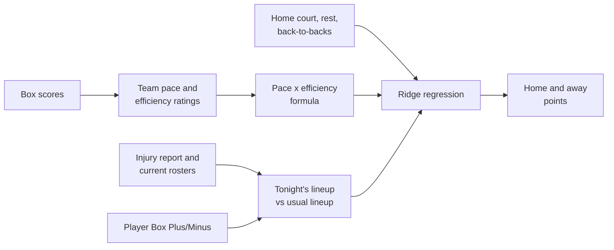
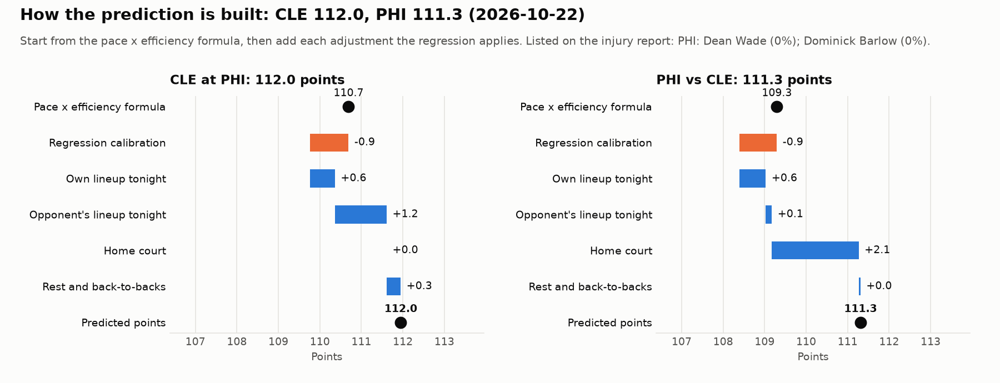
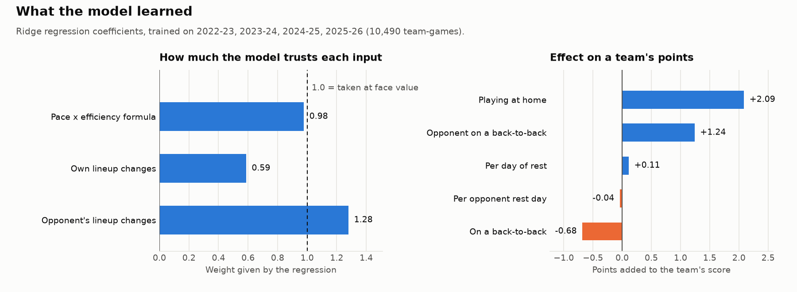

# NBA Score Model

Predicts the final score of every NBA game, and updates through the day as injury and rest news comes in.

The model is deliberately simple and explainable: a handful of predictors that carry most of the signal, combined with a ridge regression whose coefficients you can read. Every major choice is written up with its evidence in the [decision log](docs/decisions.md).

## Results

Validation seasons 2023-24 and 2024-25, 2,620 games. Each month is predicted by a model refit only on earlier games:

| | Margin error (points) | Total error (points) | Winners picked |
| --- | --- | --- | --- |
| This model | 10.94 | 14.59 | 66.7% |
| Vegas closing line | 10.62 | 14.15 | 68.7% |


The 2025-26 season is held back as a locked test set; see [How it's evaluated](#how-its-evaluated).

## How a prediction is built



Each team's points come from four ideas:

1. **Pace.** How many possessions the game will have, from both teams' recent pace.
2. **Efficiency.** The team's offensive rating (points per 100 possessions) against the opponent's defensive rating, weighted toward recent games.
3. **Tonight's lineup.** Who is in and out. Each player's Box Plus/Minus is weighed against the minutes he is expected to play tonight compared with recent games, so a star sitting out lowers his team's offense and defense.
4. **Context.** Home court, days of rest and back-to-backs.

The core is the possession formula:

```
base points = expected pace / 100 x (team ORtg + opponent DRtg - league ORtg)
```

The regression then adds the adjustments for lineups, home court and rest. `python -m nbamodel explain --game <team>` draws any game's prediction step by step:



## What the model learned



The formula is taken almost exactly at face value (about 0.98). Home court is worth about 2 points, and facing a team on the second night of a back-to-back about 1. The coefficients are saved in `data/model.json`, and every tunable setting (rating half-life, injury status probabilities, replacement-level BPM and so on) is in `src/nbamodel/config.py`.

| Feature | Meaning |
| --- | --- |
| `BASE_PTS` | Possession formula above, using recency-weighted ratings |
| `LINEUP_OFF_PTS` | Points gained or lost from who plays for this team tonight |
| `LINEUP_DEF_PTS` | Points gained or lost from who plays for the opponent tonight |
| `IS_HOME` | Home team flag |
| `REST`, `OPP_REST` | Days off before the game (capped at 3) |
| `B2B`, `OPP_B2B` | Second night of a back-to-back |

### Lineup changes

Each run reads the latest [official NBA injury report](https://official.nba.com) and turns each status into a chance of playing:

| Status | Chance of playing |
| --- | --- |
| Out | 0% |
| Doubtful | 25% |
| Questionable | 50% |
| Probable | 90% |

A missing player's minutes are handed to teammates in proportion to their usual minutes.

Each run also pulls every team's current roster. Players who have left a team are taken out of its lineup, and newcomers are added using their recent minutes and BPM from their old team. Early in a season, when team ratings still lean on last season's games, this is what accounts for offseason trades and signings. The effect fades on its own as the new roster plays games together. You can override any status by adding a row to `manual_status.csv`, which is handy for late scratches.

## How it's evaluated


`python -m nbamodel evaluate` is the yardstick for every modeling change:

- **Rolling-origin cross-validation.** For each month of the validation seasons, the regression is refit on every earlier game and predicts that month, which is how the live model runs. No fold trains on a later game.
- **A locked test season.** 2025-26 is never used to choose anything. `evaluate --final` scores it with the current settings and appends the result, commit and settings to `results/test_log.md`, so every look at the test set is on record (one early look, from before the lock, is noted in the [decision log](docs/decisions.md#5-evaluation-design)).
- **A selection rule fixed in advance.** Margin error, then total error, then total bias nearest zero; near-ties go to the simpler model.
- **Complexity and learning curves** for ridge strength and for how much history the model needs.
- **Vegas benchmark.** Closing spreads and totals from ESPN's public API, compared game by game.

Full tables are in [results/evaluation.md](results/evaluation.md). `python -m nbamodel backtest` gives a simpler season-by-season check in [results/backtest.md](results/backtest.md). In both, lineups use who actually played (historical injury reports are not kept) and player values use only the previous season's BPM, to avoid looking ahead.

## Key decisions

Each is explained with its evidence in the [decision log](docs/decisions.md):

- [Ratings + ridge regression](docs/decisions.md#1-model-approach) over the plain formula or a black-box model
- [Official data sources](docs/decisions.md#2-data-sources) and [Box Plus/Minus](docs/decisions.md#3-player-value) for player value
- [Rolling monthly evaluation with a locked test season](docs/decisions.md#5-evaluation-design)
- [Playoff games kept in ratings](docs/decisions.md#6-playoff-games-in-ratings) and [ridge alpha 10](docs/decisions.md#7-ridge-strength)

## Data

| Data | Source |
| --- | --- |
| Box scores, schedule | stats.nba.com through [nba_api](https://github.com/swar/nba_api) |
| Box Plus/Minus | [Basketball-Reference](https://www.basketball-reference.com) season advanced stats (one page per season) |
| Injuries and rest | Official NBA injury report PDFs |
| Vegas closing lines (benchmark only) | ESPN's public odds archive |

stats.nba.com blocks most cloud servers, so the data steps are meant to run from a home internet connection. `python -m nbamodel injuries` shows exactly which players the injury report reader found, to compare with the PDF.

## Setup

Requires Python 3.10 or newer. On Windows, if `python` prints "Python was not found", the command is hitting a Microsoft Store shortcut: try `python3` or `py` instead, or turn off the "App Installer" python entries under Settings > Apps > Advanced app settings > App execution aliases. Once the virtual environment is active, plain `python` works.

```bash
git clone https://github.com/szroccia/nba-score-model.git
cd nba-score-model
python -m venv .venv
source .venv/bin/activate        # Windows Git Bash: source .venv/Scripts/activate
                                 # Windows Command Prompt: .venv\Scripts\activate
pip install -e ".[dev]"

python -m nbamodel fetch         # download six seasons of data (about 10 minutes)
python -m nbamodel train         # fit the model, writes data/model.json
python -m nbamodel backtest      # accuracy by season, writes results/backtest.md
python -m nbamodel evaluate      # cross-validation, tuning curves, Vegas benchmark (results/evaluation.md)
python -m nbamodel report        # redraw the charts in docs/figures
python -m nbamodel predict       # today's games
python -m nbamodel explain --game BOS   # chart of how one game's prediction is built
```

`predict` accepts `--date YYYY-MM-DD` and `--no-injury-report` (use only `manual_status.csv`).

## Daily updates

`run_daily.sh` (Mac/Linux) or `run_daily.bat` (Windows) refreshes this season's data, reads the latest injury report, writes `predictions/<date>.csv` and pushes the predictions folder to a `predictions` branch on the git remote set in `config.PREDICTIONS_REMOTE`, kept apart from the code. Run it twice a day: once in the morning and once about an hour before the first game.

Mac/Linux, with `crontab -e` (times are your computer's local time):

```
0 11 * * *  /path/to/nba-score-model/run_daily.sh >> /tmp/nba-daily.log 2>&1
0 18 * * *  /path/to/nba-score-model/run_daily.sh >> /tmp/nba-daily.log 2>&1
```

Windows: in Task Scheduler, create a task that runs `run_daily.bat` daily at those times.

When a later run changes a prediction by a point or more, the change and the players behind it are added to `predictions/<date>_changes.md`.

## Output

`predictions/<date>.csv` has one row per game:

| Column | Meaning |
| --- | --- |
| `away_pts`, `home_pts` | Predicted final score |
| `home_margin`, `total` | Home points minus away points, and combined points |
| `home_lineup_pts`, `away_lineup_pts` | How much tonight's lineups moved that team's margin |
| `home_missing`, `away_missing` | Rotation players with less than a 100% chance of playing |

`predictions/<date>_details.csv` has one row per team with every input and the points each step adds, which is what `explain` draws.

## Limitations and ideas

- Ratings are not adjusted for strength of schedule yet.
- The model is limited by its inputs rather than by data (see the [learning curve](docs/decisions.md#7-ridge-strength)), so richer features are the next step.
- Minutes for absent players are redistributed in proportion to usual minutes, not by position.
- Rookies have no NBA minutes or BPM, so they count only once they start playing.
- Box Plus/Minus misses defense that doesn't show up in the box score.

## Tests

```bash
pytest
```
