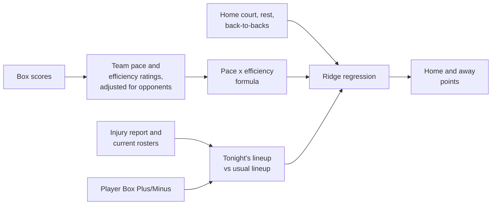

# NBA Score Model

Predicts the final score of every NBA game, and updates through the day as injury and rest news comes in.

The model is deliberately simple and explainable: a handful of predictors that carry most of the signal, combined with a ridge regression whose coefficients you can read. Every major choice is written up with its evidence in the [decision log](docs/decisions.md).

## Results

Validation seasons 2023-24 and 2024-25, 2,620 games. Each month is predicted by a model refit only on earlier games:

| | Margin error (points) | Total error (points) | Winners picked |
| --- | --- | --- | --- |
| This model | 10.86 | 14.63 | 67.2% |
| Vegas closing line | 10.62 | 14.15 | 68.7% |


Each prediction also comes with a win probability, from how far the model's predictions missed in earlier months. When it gives the home team 70%, the home team wins about 70% of the time ([decision 13](docs/decisions.md#13-how-sure-is-each-prediction)).

Season and playoff odds come from playing out the rest of the season 10,000 times. Simulated from the first of each month of 2023-24 and 2024-25, with only what was known that day, they scored a log loss of 0.31 on who made the playoffs (0.69 for giving every team 53%), and both champions had the best or second-best title odds all season ([decision 14](docs/decisions.md#14-season-and-playoff-odds)).

The 2025-26 season is held back as a locked test set; see [How it's evaluated](#how-its-evaluated).

## How a prediction is built



Each team's points come from four ideas:

1. **Pace.** How many possessions the game will have, from both teams' recent pace.
2. **Efficiency.** The team's offensive rating (points per 100 possessions) against the opponent's defensive rating, weighted toward recent games. Each past game is corrected for how good that opponent was, so a team with a hard schedule isn't underrated. When a team's results shift sharply, a change detector (CUSUM) flags it and the games before the shift count less.
3. **Tonight's lineup.** Who is in and out. Each player's Box Plus/Minus is weighed against the minutes he is expected to play tonight compared with recent games, so a star sitting out lowers his team's offense and defense.
4. **Context.** Home court, days of rest and back-to-backs.

The core is the possession formula:

```
base points = expected pace / 100 x (team ORtg + opponent DRtg - league ORtg)
```

The regression then adds the adjustments for lineups, home court and rest. `python -m nbamodel explain --game <team>` draws any game's prediction step by step:


## What the model learned


The formula is taken almost at face value (about 0.98). Home court is worth about 2 points, and facing a team on the second night of a back-to-back about 1. The coefficients are saved in `data/model.json`, and every tunable setting (rating half-life, injury status probabilities, replacement-level BPM and so on) is in `src/nbamodel/config.py`.

| Feature | Meaning |
| --- | --- |
| `BASE_PTS` | Possession formula above, using recency-weighted, opponent-adjusted ratings |
| `LINEUP_OFF_PTS` | Points gained or lost from who plays for this team tonight |
| `LINEUP_DEF_PTS` | Points gained or lost from who plays for the opponent tonight |
| `IS_HOME` | Home team flag |
| `REST`, `OPP_REST` | Days off before the game (capped at 3) |
| `B2B`, `OPP_B2B` | Second night of a back-to-back |

### Lineup changes

Each run reads the latest [official NBA injury report](https://official.nba.com) and turns each status into a chance of playing:

| Status | Chance of playing |
| --- | --- |
| Out | 0% |
| Doubtful | 25% |
| Questionable | 50% |
| Probable | 90% |

A missing player's minutes are handed to teammates in proportion to their usual minutes.

Each run also pulls every team's current roster. Players who have left a team are taken out of its lineup, and newcomers are added using their recent minutes and BPM from their old team. Early in a season, when team ratings still lean on last season's games, this is what accounts for offseason trades and signings. The effect fades on its own as the new roster plays games together. You can override any status by adding a row to `manual_status.csv`, which is handy for late scratches.

## How it's evaluated


`python -m nbamodel evaluate` is the yardstick for every modeling change:

- **Rolling-origin cross-validation.** For each month of the validation seasons, the regression is refit on every earlier game and predicts that month, which is how the live model runs. No fold trains on a later game.
- **A locked test season.** 2025-26 is never used to choose anything. `evaluate --final` scores it with the current settings and appends the result, commit and settings to `results/test_log.md`, so every look at the test set is on record (one early look, from before the lock, is noted in the [decision log](docs/decisions.md#5-evaluation-design)).
- **A selection rule fixed in advance.** Margin error, then total error, then total bias nearest zero; near-ties go to the simpler model.
- **Complexity and learning curves** for ridge strength and for how much history the model needs.
- **Vegas benchmark.** Closing spreads and totals from ESPN's public API, compared game by game.

`python -m nbamodel compare` runs seven other kinds of model through the same months, each picking its own settings using only earlier games. None beat ridge regression:


`python -m nbamodel probability` checks the win probabilities the same way, scoring each month with chances learned only from earlier months' misses:


`python -m nbamodel season --backtest` plays out past seasons from the first of each month with only what was known that day, and checks the playoff odds against who made it:


Full tables are in [results/evaluation.md](results/evaluation.md), [results/comparison.md](results/comparison.md), [results/probability.md](results/probability.md) and [results/season.md](results/season.md). `python -m nbamodel backtest` gives a simpler season-by-season check in [results/backtest.md](results/backtest.md). In all of them, lineups use who actually played (historical injury reports are not kept) and player values use only the previous season's BPM, to avoid looking ahead.

## Key decisions

Each is explained with its evidence in the [decision log](docs/decisions.md):

- [Ratings + ridge regression](docs/decisions.md#1-model-approach) over the plain formula or a black-box model
- [Official data sources](docs/decisions.md#2-data-sources) and [Box Plus/Minus](docs/decisions.md#3-player-value) for player value
- [Rolling monthly evaluation with a locked test season](docs/decisions.md#5-evaluation-design)
- [Playoff games kept in ratings](docs/decisions.md#6-playoff-games-in-ratings) and [ridge alpha 10](docs/decisions.md#7-ridge-strength)
- [Strength-of-schedule adjustment](docs/decisions.md#8-strength-of-schedule), kept because it beat a noise test fixed in advance
- [Four factors](docs/decisions.md#9-four-factors), tested and left out: they helped totals but hurt margins
- [Hand-picked settings tuned](docs/decisions.md#10-hand-picked-settings): 3 of 8 changed after a test fixed in advance, with longer memory for team ratings and player minutes
- [Ridge regression kept over seven other kinds of model](docs/decisions.md#11-kinds-of-model): a neural network, gradient boosting, random forest and others fit past games better but predicted new months worse
- [Better team ratings](docs/decisions.md#12-better-team-ratings): change detection (CUSUM) added after a test fixed in advance; a season-start prior and a trend were tested and left out
- [Win probability from a normal spread](docs/decisions.md#13-how-sure-is-each-prediction): logistic and isotonic calibration tied it; odds against the betting line did no better than a coin flip, so they aren't shown
- [Season odds from simulated seasons](docs/decisions.md#14-season-and-playoff-odds) with fresh luck in every game: lasting team errors tied on playoff odds, though their win ranges fit better

## Data

| Data | Source |
| --- | --- |
| Box scores, schedule | stats.nba.com through [nba_api](https://github.com/swar/nba_api) |
| Box Plus/Minus | [Basketball-Reference](https://www.basketball-reference.com) season advanced stats (one page per season) |
| Injuries and rest | Official NBA injury report PDFs |
| Vegas closing lines (benchmark only) | ESPN's public odds archive |

stats.nba.com blocks most cloud servers, so the data steps are meant to run from a home internet connection. `python -m nbamodel injuries` shows exactly which players the injury report reader found, to compare with the PDF.

## Setup

Requires Python 3.10 or newer. On Windows, if `python` prints "Python was not found", the command is hitting a Microsoft Store shortcut: try `python3` or `py` instead, or turn off the "App Installer" python entries under Settings > Apps > Advanced app settings > App execution aliases. Once the virtual environment is active, plain `python` works.

```bash
git clone https://github.com/szroccia/nba-score-model.git
cd nba-score-model
python -m venv .venv
source .venv/bin/activate        # Windows Git Bash: source .venv/Scripts/activate
                                 # Windows Command Prompt: .venv\Scripts\activate
pip install -e ".[dev]"

python -m nbamodel fetch         # download six seasons of data (about 10 minutes)
python -m nbamodel validate      # sanity checks + games to compare with nba.com
python -m nbamodel train         # fit the model, writes data/model.json
python -m nbamodel backtest      # accuracy by season, writes results/backtest.md
python -m nbamodel evaluate      # cross-validation, tuning curves, Vegas benchmark (results/evaluation.md)
python -m nbamodel evaluate --compare all   # adds a with/without table for each setting decision
python -m nbamodel tune          # tests the hand-picked settings one by one (results/tuning.md)
python -m nbamodel compare       # other kinds of model against ridge regression (results/comparison.md)
python -m nbamodel tune --ratings # tests changes to how team ratings are built (results/ratings_tuning.md)
python -m nbamodel probability   # win probability, score ranges, cover and over/under odds (results/probability.md)
python -m nbamodel season --backtest   # tests the season simulation on past seasons (results/season.md)
python -m nbamodel report        # redraw the charts in docs/figures
python -m nbamodel predict       # today's games
python -m nbamodel season        # season and playoff odds from today
python -m nbamodel explain --game BOS   # chart of how one game's prediction is built
```

`predict` accepts `--date YYYY-MM-DD` and `--no-injury-report` (use only `manual_status.csv`). `season` accepts `--date` too.

## Checking the data

`python -m nbamodel validate` checks every season's download: game counts (1,230 per regular season), two teams per game, box scores that add up (points = 2 x FGM + 3PM + FTM), team totals that match the separately downloaded player totals, and how many minutes were matched to a Basketball-Reference BPM. It also prints a few random games with links to their official nba.com box scores so you can compare by eye. The raw CSV files are all in `data/`.

## Daily updates

`run_daily.sh` (Mac/Linux) or `run_daily.bat` (Windows) refreshes this season's data, reads the latest injury report, writes `predictions/<date>.csv`, updates the season and playoff odds in `predictions/<date>_season.csv` (until the regular season ends) and pushes the predictions folder to a `predictions` branch on the git remote set in `config.PREDICTIONS_REMOTE`, kept apart from the code. Run it twice a day: once in the morning and once about an hour before the first game.

Mac/Linux, with `crontab -e` (times are your computer's local time):

```
0 11 * * *  /path/to/nba-score-model/run_daily.sh >> /tmp/nba-daily.log 2>&1
0 18 * * *  /path/to/nba-score-model/run_daily.sh >> /tmp/nba-daily.log 2>&1
```

Windows: run this once from the repo folder (in Git Bash, PowerShell or Command Prompt):

```
powershell -ExecutionPolicy Bypass -File schedule_daily.ps1
```

It adds a Task Scheduler task, "NBA daily predictions", that runs `run_daily.bat` at 11:00 and 18:00 and appends each run's output to `daily.log`. A console window shows while it runs. The computer needs to be on or asleep (the task wakes it) and you need to be signed in; a missed run is harmless, because the next one catches up on every game since. To test it now, run `schtasks /run /tn "NBA daily predictions"` (in Git Bash, `schtasks //run //tn "NBA daily predictions"`) and check `daily.log` a few minutes later. To remove it, `schtasks /delete /tn "NBA daily predictions" /f`.

When a later run changes a prediction by a point or more, the change and the players behind it are added to `predictions/<date>_changes.md`. A later run never changes a game that has already tipped off: it keeps the earlier prediction, so every saved prediction was made before its game started.

## Output

`predictions/<date>.csv` has one row per game:

| Column | Meaning |
| --- | --- |
| `away_pts`, `home_pts` | Predicted final score |
| `home_margin`, `total` | Home points minus away points, and combined points |
| `home_win_prob` | Chance the home team wins, from how far the model's past predictions missed ([decision 13](docs/decisions.md#13-how-sure-is-each-prediction)) |
| `vegas_margin`, `vegas_total` | Today's betting line from ESPN at the time of the run: the expected home margin (5.5 = home favored by 5.5) and total |
| `margin_vs_vegas`, `total_vs_vegas` | The model's margin and total minus the line's |
| `home_lineup_pts`, `away_lineup_pts` | How much tonight's lineups moved that team's margin |
| `home_missing`, `away_missing` | Rotation players with less than a 100% chance of playing |
| `vegas_book` | The sportsbook the line came from |
| `tip_off`, `predicted_at` | Scheduled tip-off and when the prediction was made, both in UTC |

Odds that the home team covers the spread (`home_cover_prob`) or that the game goes over the total (`over_prob`) are added only if decision 13's test finds a way to give them that beats a coin flip.

`predictions/<date>_details.csv` has one row per team with every input and the points each step adds, which is what `explain` draws.

`predictions/<date>_season.csv` has one row per team, from playing out the rest of the regular season and the playoffs 10,000 times ([decision 14](docs/decisions.md#14-season-and-playoff-odds)). Rosters are today's, with everyone healthy except players in `manual_status.csv`, who stay at that status for the rest of the season.

| Column | Meaning |
| --- | --- |
| `wins_now`, `losses_now`, `games_left` | Record so far and games still to play |
| `wins`, `wins_low`, `wins_high` | Average simulated win total, and the middle 80% of simulated win totals (too narrow: in the backtest, 62% of actual totals landed inside) |
| `top6`, `play_in` | Chance of finishing in the top six of the conference, or 7th to 10th |
| `playoffs` | Chance of reaching the playoffs, directly or through the play-in |
| `round2`, `conf_finals`, `finals`, `title` | Chance of reaching each later round, and of winning the title |
| `method`, `simulations` | How simulated games were drawn, and how many seasons were played out |

## Limitations and ideas

- The model is limited by its inputs, not by data or the kind of model (see the [learning curve](docs/decisions.md#7-ridge-strength) and the [model comparison](docs/decisions.md#11-kinds-of-model)), so richer features are the next step.
- Minutes for absent players are redistributed in proportion to usual minutes, not by position.
- Rookies have no NBA minutes or BPM, so they count only once they start playing.
- Box Plus/Minus misses defense that doesn't show up in the box score.
- Season win ranges are too narrow: simulated games get fresh luck every night, which evens out, while real teams drift from their ratings for weeks at a time ([decision 14](docs/decisions.md#14-season-and-playoff-odds)).

## Tests

```bash
pytest
```
