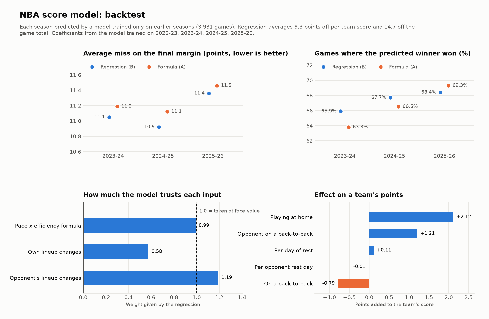

# NBA Score Model

Predicts the final score of every NBA game, and updates through the day as injury and rest news comes in.

The model is deliberately simple: a handful of predictors that carry most of the signal, combined with a ridge regression whose coefficients you can read.

## How it works

Each team's points are predicted from four ideas:

1. **Pace.** How many possessions the game will have, from both teams' recent pace.
2. **Efficiency.** The team's offensive rating (points per 100 possessions) against the opponent's defensive rating, weighted toward recent games.
3. **Tonight's lineup.** Who is in and out. Each player's Box Plus/Minus is weighed against the minutes he is expected to play tonight compared with recent games, so a star sitting out lowers his team's offense and defense.
4. **Context.** Home court, days of rest and back-to-backs.

The core of the prediction is the possession formula:

```
base points = expected pace / 100 x (team ORtg + opponent DRtg - league ORtg)
```

A ridge regression then learns how much weight to give the base points, the lineup changes, home court and rest. Each game gets a home score and an away score, so the margin and total come with it.

| Feature | Meaning |
| --- | --- |
| `BASE_PTS` | Possession formula above, using recency-weighted ratings |
| `LINEUP_OFF_PTS` | Points gained or lost from who plays for this team tonight |
| `LINEUP_DEF_PTS` | Points gained or lost from who plays for the opponent tonight |
| `IS_HOME` | Home team flag |
| `REST`, `OPP_REST` | Days off before the game (capped at 3) |
| `B2B`, `OPP_B2B` | Second night of a back-to-back |

The trained coefficients are saved in `data/model.json`. Every tunable setting (rating half-life, injury status probabilities, replacement-level BPM and so on) is in `src/nbamodel/config.py`.

### Lineup changes

Each run reads the latest [official NBA injury report](https://official.nba.com) and turns each status into a chance of playing:

| Status | Chance of playing |
| --- | --- |
| Out | 0% |
| Doubtful | 25% |
| Questionable | 50% |
| Probable | 90% |

A missing player's minutes are handed to teammates in proportion to their usual minutes.

Each run also pulls every team's current roster. Players who have left a team are taken out of its lineup, and newcomers are added using their recent minutes and BPM from their old team. Early in a season, when team ratings still lean on last season's games, this is what accounts for offseason trades and signings. The effect fades on its own as the new roster plays games together. You can override any status by adding a row to `manual_status.csv`, which is handy for late scratches.

## Data

| Data | Source |
| --- | --- |
| Box scores, schedule | stats.nba.com through [nba_api](https://github.com/swar/nba_api) |
| Box Plus/Minus | [Basketball-Reference](https://www.basketball-reference.com) season advanced stats (one page per season) |
| Injuries and rest | Official NBA injury report PDFs |

stats.nba.com blocks most cloud servers, so the data steps are meant to run from a home internet connection. `python -m nbamodel injuries` shows exactly which players the injury report reader found, to compare with the PDF.

## Setup

Requires Python 3.10 or newer. On Windows, if `python` prints "Python was not found", the command is hitting a Microsoft Store shortcut: try `python3` or `py` instead, or turn off the "App Installer" python entries under Settings > Apps > Advanced app settings > App execution aliases. Once the virtual environment is active, plain `python` works.

```bash
git clone https://github.com/szroccia/nba-score-model.git
cd nba-score-model
python -m venv .venv
source .venv/bin/activate        # Windows Git Bash: source .venv/Scripts/activate
                                 # Windows Command Prompt: .venv\Scripts\activate
pip install -e ".[dev]"

python -m nbamodel fetch         # download six seasons of data (about 10 minutes)
python -m nbamodel train         # fit the model, writes data/model.json
python -m nbamodel backtest      # accuracy by season, writes results/backtest.md
python -m nbamodel report        # chart of the backtest, writes results/backtest.png
python -m nbamodel predict       # today's games
```

`predict` accepts `--date YYYY-MM-DD` and `--no-injury-report` (use only `manual_status.csv`).

### Playoff games in ratings

Playoff games are slower and lower scoring than the regular season, which matters most early in a season, when ratings still lean on last season's final games. `PLAYOFF_GAMES` in `config.py` chooses how they're used: `include` (as is), `exclude`, or `relative` (counted, but measured against the playoff league average). `python -m nbamodel backtest --playoffs all` compares all three, including a row for each season's first 15 games, in `results/playoff_comparison.md`.

## Daily updates

`run_daily.sh` (Mac/Linux) or `run_daily.bat` (Windows) refreshes this season's data, reads the latest injury report, writes `predictions/<date>.csv` and pushes it to GitHub. Run it twice a day: once in the morning and once about an hour before the first game.

Mac/Linux, with `crontab -e` (times are your computer's local time):

```
0 11 * * *  /path/to/nba-score-model/run_daily.sh >> /tmp/nba-daily.log 2>&1
0 18 * * *  /path/to/nba-score-model/run_daily.sh >> /tmp/nba-daily.log 2>&1
```

Windows: in Task Scheduler, create a task that runs `run_daily.bat` daily at those times.

When a later run changes a prediction by a point or more, the change and the players behind it are added to `predictions/<date>_changes.md`.

## Output

`predictions/<date>.csv` has one row per game:

| Column | Meaning |
| --- | --- |
| `away_pts`, `home_pts` | Predicted final score |
| `home_margin`, `total` | Home points minus away points, and combined points |
| `home_lineup_pts`, `away_lineup_pts` | How much tonight's lineups moved that team's margin |
| `home_missing`, `away_missing` | Rotation players with less than a 100% chance of playing |

## Backtest

`python -m nbamodel backtest` predicts each season with a model trained only on earlier seasons, and compares it with the plain possession formula. Results are written to [results/backtest.md](results/backtest.md). `python -m nbamodel report` turns them and the model's coefficients into a chart:



In the backtest, lineups use who actually played in each game, because historical injury reports are not kept in the data. Player values use only the previous season's BPM to avoid looking ahead.

## Limitations and ideas

- Ratings are not adjusted for strength of schedule yet.
- Minutes for absent players are redistributed in proportion to usual minutes, not by position.
- Rookies have no NBA minutes or BPM, so they count only once they start playing.
- Box Plus/Minus misses defense that doesn't show up in the box score.
- Comparing against Vegas closing lines would give a stronger benchmark.

## Tests

```bash
pytest
```
