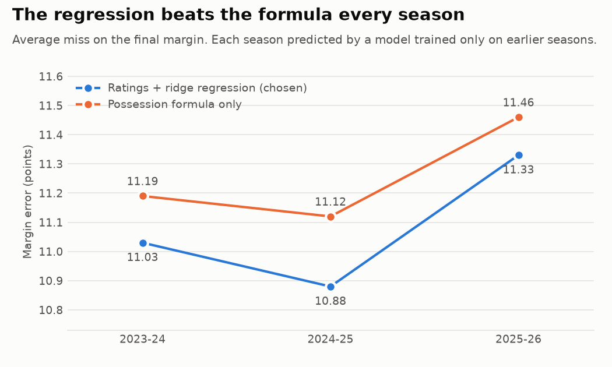
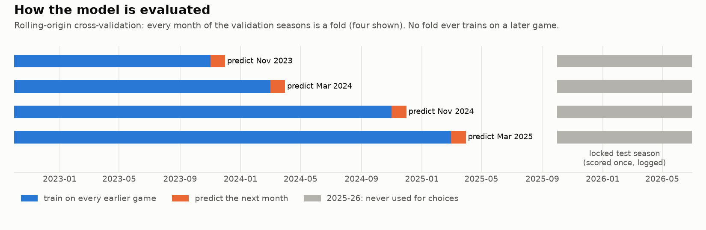
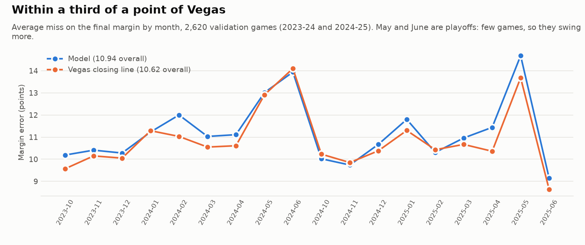
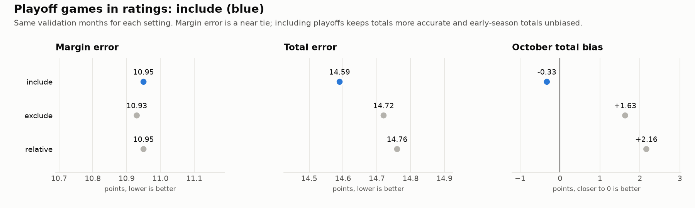
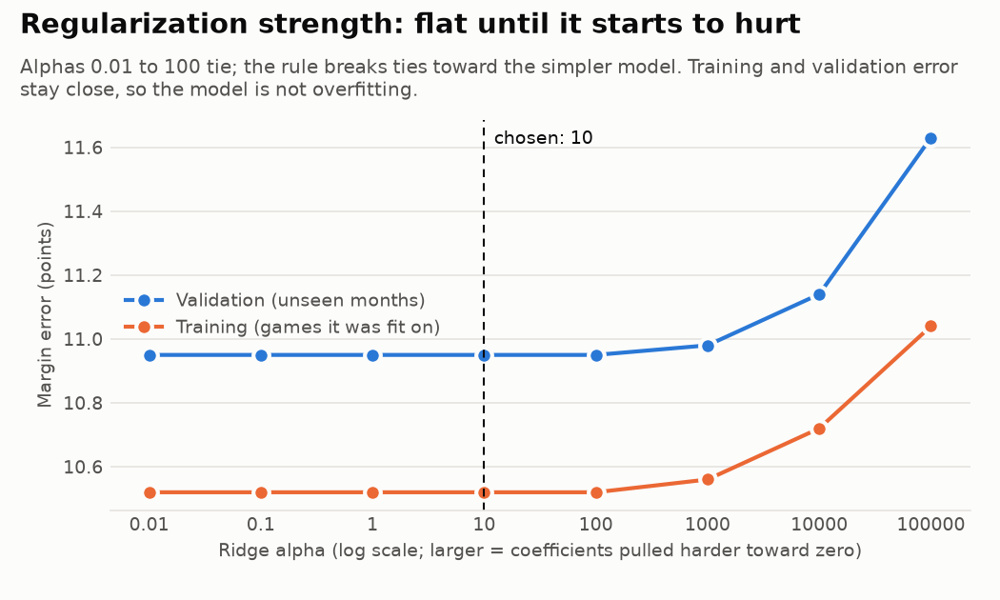
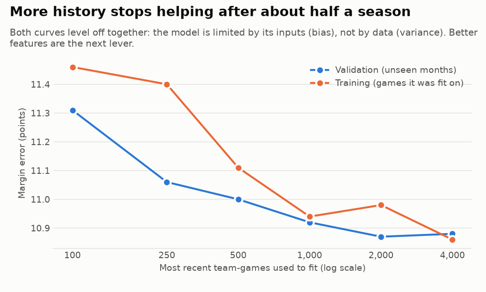

# Decision log

The major modeling choices, what was considered, the evidence and the reason for each choice. Every chart here is drawn by `python -m nbamodel report` from results files in this repo, so all of them can be reproduced.

**How decisions are made.** Each choice is a setting in `src/nbamodel/config.py`. The test that settles it is fixed before the results are seen. Choices are judged only on the validation seasons; the test season is kept for a final, logged check (see [Evaluation design](#5-evaluation-design)).

| # | Decision | Choice | Evidence |
| --- | --- | --- | --- |
| 1 | [Model approach](#1-model-approach) | Team ratings + ridge regression | Beats the plain formula every season |
| 2 | [Data sources](#2-data-sources) | Official NBA stats and injury report, run from a home connection | Most reliable sources; cloud servers are blocked |
| 3 | [Player value](#3-player-value) | Box Plus/Minus, weighted by expected minutes | Lineup inputs earn real weight in the regression |
| 4 | [Offseason roster moves](#4-offseason-roster-moves) | Current rosters shift last season's ratings | Needed for October, when ratings are mostly last season |
| 5 | [Evaluation design](#5-evaluation-design) | Rolling monthly folds, locked test season, Vegas benchmark | Avoids look-ahead and gives an honest bar to beat |
| 6 | [Playoff games in ratings](#6-playoff-games-in-ratings) | Include | Best total error and early-season bias |
| 7 | [Ridge strength](#7-ridge-strength) | alpha = 10 | All reasonable values tie; ties go to the simpler model |

---

## 1. Model approach

**Options.**
- **(A) Possession formula only:** pace × (offense + opponent defense − league average).
- **(B) The same ratings fed into a ridge regression** with lineup, home and rest inputs.
- **(C) Gradient boosting** on a wide feature set.

**Choice: B.** The regression learns how much to trust each input instead of fixing the weights by hand, and its coefficients can be read directly ([What the model learned](../README.md#what-the-model-learned)). C can find interactions but is harder to explain and needs more features. It is planned as a later comparison, judged by the same evaluation.

**Evidence.** On average the regression's margin error is 0.13 to 0.24 points lower than the formula's in every backtest season:

## 2. Data sources

**Options:** official stats.nba.com data (through `nba_api`) run from a home connection; ESPN and Basketball-Reference run in the cloud; or a mix.

**Choice: official sources.**

| Data | Source |
| --- | --- |
| Box scores and schedule | stats.nba.com through `nba_api` |
| Injury and rest news | Official NBA injury report PDFs |
| Player value | Basketball-Reference |
| Benchmark | ESPN's archive of Vegas closing lines |

stats.nba.com blocks cloud servers, so the data steps run on a home computer. A data-check command (game counts, box scores that add up, team totals matching player totals) is in review alongside the strength-of-schedule change.

## 3. Player value

**Choice: Box Plus/Minus (BPM),** split into offense and defense. Each player's value is weighted by the minutes he is expected to play tonight compared with recent games. Last season's BPM is blended with this season's until a player has about 500 minutes.

**Why.** BPM exists for every player in every season, separates offense from defense, and is public, so anyone can check it.

**Evidence and limits.** The regression gives the lineup inputs real weight: about 1.25 for the opponent's lineup and 0.6 for the team's own ([coefficients](figures/coefficients.png)). So who plays carries signal, and the model trusts BPM-based shifts to its own offense at a bit over half their face value. BPM misses defense that doesn't show up in the box score.

## 4. Offseason roster moves

**Options:** only use who played recently, or pull current rosters and let them shift last season's ratings.

**Choice: current rosters.**
- Players who left a team are removed from its lineup.
- Newcomers are added with their minutes and BPM from their old team.

In October, team ratings are mostly last season's games, so this is what accounts for trades and signings. The shift fades on its own as the new roster plays games together.

## 5. Evaluation design

**Choice:** rolling-origin cross-validation by month, a locked test season, a selection rule fixed in advance, and Vegas closing lines as the benchmark.

**Why.**
- **No look-ahead:** basketball data is a time series, so random k-fold splits would train on games played after the ones being predicted. Refitting before each month and predicting that month is also exactly how the live model runs.
- **Untouched test season:** 2025-26 is never used to choose anything. Every look at it is appended to `results/test_log.md`.
- **A rule fixed in advance:** settings are ranked by margin error, then total error, then total bias nearest zero, with near-ties going to the simpler model.
- **A real bar to beat:** the closing line is the best public forecast.

**Evidence.** On 2,620 validation games the model is within a third of a point of Vegas:

| | Margin error | Total error | Winners picked |
| --- | --- | --- | --- |
| Model | 10.94 | 14.59 | 66.7% |
| Vegas closing line | 10.62 | 14.15 | 68.7% |

## 6. Playoff games in ratings

**Question.** Playoff games are slower and lower scoring, and early in a season they make up a big share of each team's recent games. Should ratings use them as they are, leave them out, or rescale them to the playoff league average?

**Test fixed in advance:** margin error, total error, and total bias in October (the month most affected), on the same validation folds.

**Choice: include.**
- Margin error is a near tie: exclude is 0.02 points better, well within game-to-game noise.
- Including playoffs gives the lowest total error (by 0.13).
- It is also the only setting that doesn't push October totals 1.6 to 2.2 points too high.

## 7. Ridge strength

**Question.** How hard should ridge regression pull the coefficients toward zero (`RIDGE_ALPHA`)?

**Choice: alpha = 10.**
- Every alpha from 0.01 to 100 gives the same validation error (10.95).
- With about 10,000 games and only 8 inputs, a small penalty barely moves the coefficients.
- Under the selection rule, ties go to the simpler (more regularized) model, which is 10.
- Error only rises once alpha reaches 1,000 and starts shrinking real effects.

**What this says about the model.** Training and validation error stay close at every alpha, so the model is not overfitting. The learning curve agrees: accuracy stops improving after about half a season of history. The model is limited by its inputs (bias), not by data or variance, so better features are the next lever.

---

**Next decision:** strength-of-schedule adjusted ratings, judged by the same evaluation.
