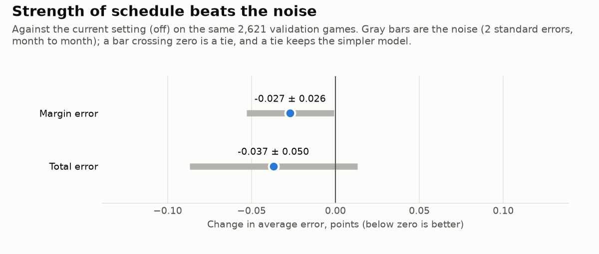
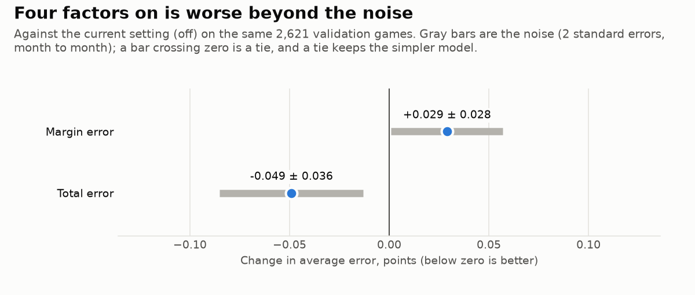
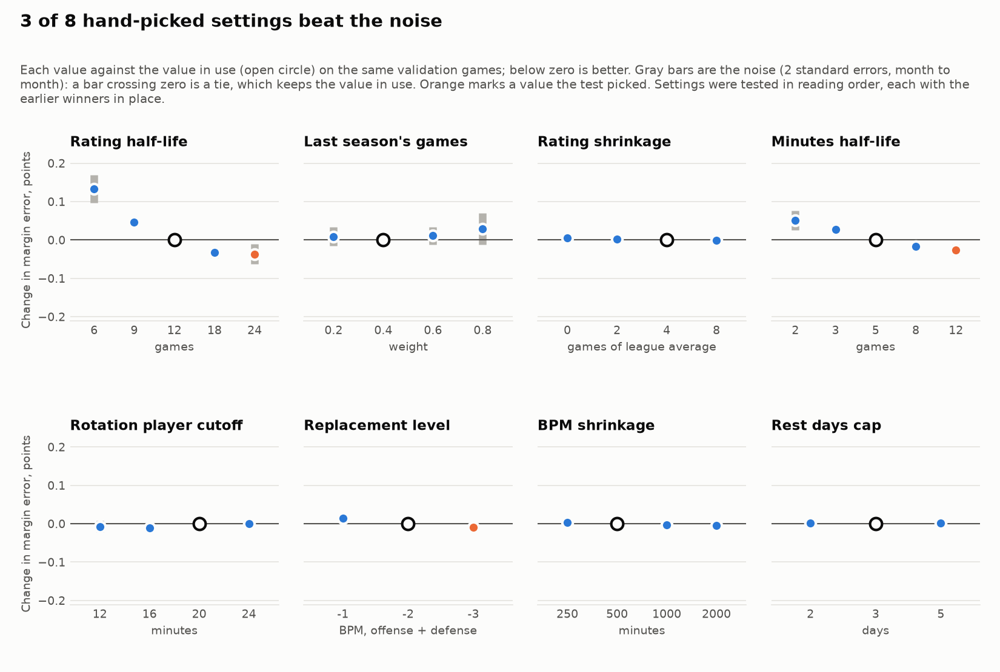
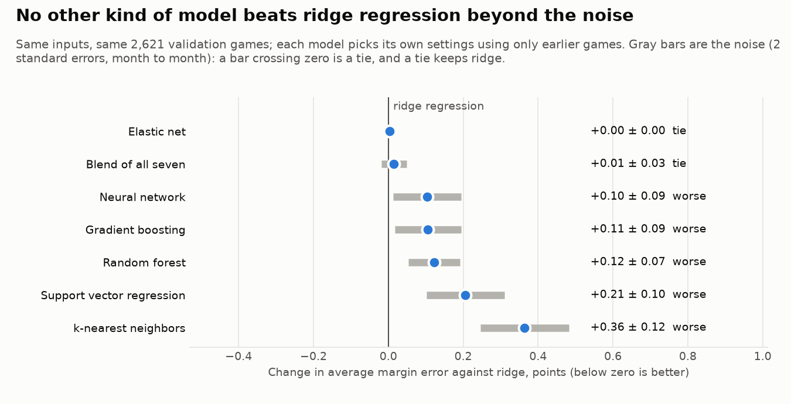
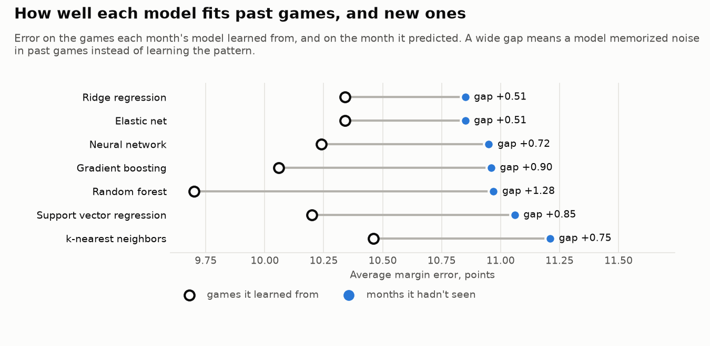
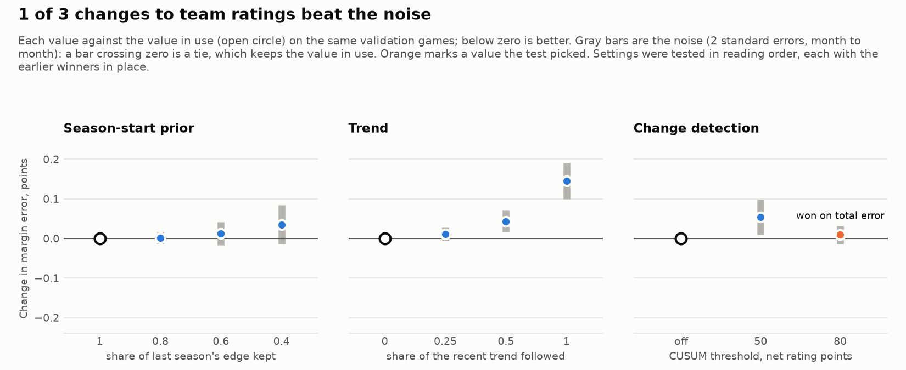
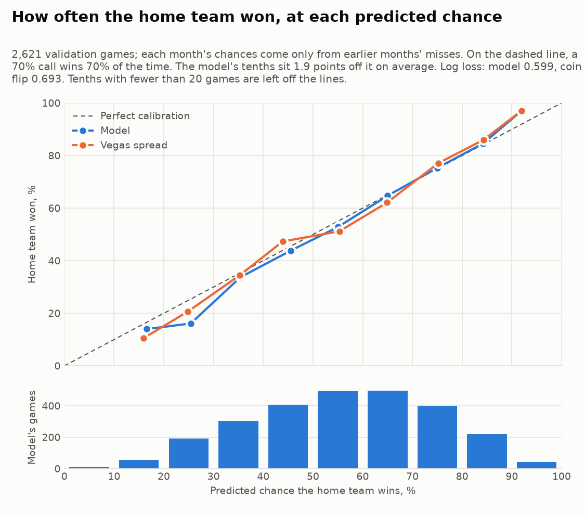
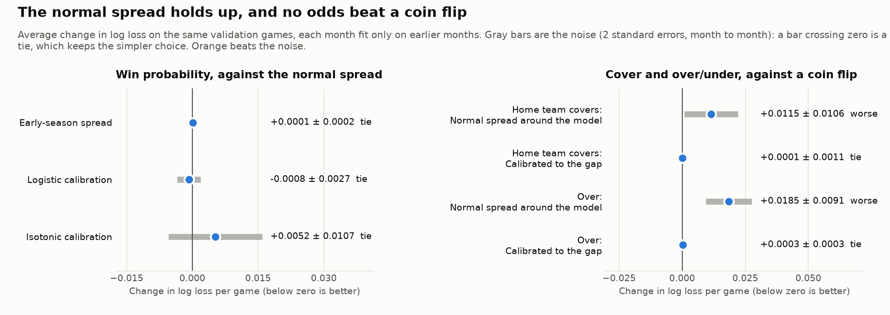
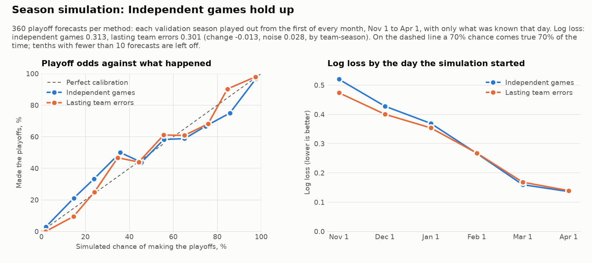

# Decision log

The major modeling choices, what was considered, the evidence and the reason for each choice. Every chart here is drawn by `python -m nbamodel report` from results files in this repo, so all of them can be reproduced.

**How decisions are made.** Each choice is a setting in `src/nbamodel/config.py`. The test that settles it is fixed before the results are seen. Choices are judged only on the validation seasons; the test season is kept for a final, logged check (see [Evaluation design](#5-evaluation-design)).

| # | Decision | Choice | Evidence |
| --- | --- | --- | --- |
| 1 | [Model approach](#1-model-approach) | Team ratings + ridge regression | Beats the plain formula in every validation season |
| 2 | [Data sources](#2-data-sources) | Official NBA stats and injury report, run from a home connection | Most reliable sources; cloud servers are blocked |
| 3 | [Player value](#3-player-value) | Box Plus/Minus, weighted by expected minutes | Lineup inputs earn real weight in the regression |
| 4 | [Offseason roster moves](#4-offseason-roster-moves) | Current rosters shift last season's ratings | Needed for October, when ratings are mostly last season |
| 5 | [Evaluation design](#5-evaluation-design) | Rolling monthly folds, locked test season, Vegas benchmark | Avoids look-ahead and gives an honest bar to beat |
| 6 | [Playoff games in ratings](#6-playoff-games-in-ratings) | Include | Best total error and early-season bias |
| 7 | [Ridge strength](#7-ridge-strength) | alpha = 10 | All reasonable values tie; ties go to the simpler model |
| 8 | [Strength of schedule](#8-strength-of-schedule) | Adjust for opponents | Beat the noise on margin error, after a fix for a flaw that biased totals |
| 9 | [Four factors](#9-four-factors) | Left out | Worse on margin error beyond the noise, though better on totals |
| 10 | [Hand-picked settings](#10-hand-picked-settings) | Rating half-life 24, minutes half-life 12, replacement level -3; five others kept | Beat the noise on margin error; total error rose 0.11 |
| 11 | [Kinds of model](#11-kinds-of-model) | Ridge regression stays | Five flexible models were worse on margin error beyond the noise; elastic net and a blend tied |
| 12 | [Better team ratings](#12-better-team-ratings) | Change detection (CUSUM) at 80; season-start prior and trend left out | CUSUM beat the noise on total error, with margin a tie; the others tied or were worse |
| 13 | [How sure is each prediction](#13-how-sure-is-each-prediction) | Normal spread for win probability; no cover or over/under odds | The calibration methods tied; odds against the line did no better than a coin flip |
| 14 | [Season and playoff odds](#14-season-and-playoff-odds) | Simulate seasons with independent luck in every game | Lasting team errors tied on playoff odds, though their win ranges fit better |

---

## 1. Model approach

**Options.**
- **(A) Possession formula only:** pace × (offense + opponent defense − league average).
- **(B) The same ratings fed into a ridge regression** with lineup, home and rest inputs.
- **(C) Gradient boosting** on a wide feature set.

**Choice: B.** The regression learns how much to trust each input instead of fixing the weights by hand, and its coefficients can be read directly ([What the model learned](../README.md#what-the-model-learned)). C can find interactions but is harder to explain and needs more features. It is planned as a later comparison, judged by the same evaluation.

**Evidence.** The regression's average margin error is 0.16 and 0.24 points lower than the formula's in the two validation seasons:

## 2. Data sources

**Options:** official stats.nba.com data (through `nba_api`) run from a home connection; ESPN and Basketball-Reference run in the cloud; or a mix.

**Choice: official sources.**

| Data | Source |
| --- | --- |
| Box scores and schedule | stats.nba.com through `nba_api` |
| Injury and rest news | Official NBA injury report PDFs |
| Player value | Basketball-Reference |
| Benchmark | ESPN's archive of Vegas closing lines |

stats.nba.com blocks cloud servers, so the data steps run on a home computer. `python -m nbamodel validate` checks every download: game counts, box scores that add up, team totals matching player totals, and games still in progress, which are left out.

## 3. Player value

**Choice: Box Plus/Minus (BPM),** split into offense and defense. Each player's value is weighted by the minutes he is expected to play tonight compared with recent games. Last season's BPM is blended with this season's: they count equally once a player has 500 minutes this season, and this season's counts more after that.

**Why.** BPM exists for every player in every season, separates offense from defense, and is public, so anyone can check it.

**Evidence and limits.** The regression gives the lineup inputs real weight: about 1.25 for the opponent's lineup and 0.6 for the team's own ([coefficients](figures/coefficients.png)). So who plays carries signal, and the model trusts BPM-based shifts to its own offense at a bit over half their face value. BPM misses defense that doesn't show up in the box score.

## 4. Offseason roster moves

**Options:** only use who played recently, or pull current rosters and let them shift last season's ratings.

**Choice: current rosters.**
- Players who left a team are removed from its lineup.
- Newcomers are added with their minutes and BPM from their old team.

In October, team ratings are mostly last season's games, so this is what accounts for trades and signings. The shift fades on its own as the new roster plays games together.

## 5. Evaluation design

**Choice:** rolling-origin cross-validation by month, a locked test season, a selection rule fixed in advance, and Vegas closing lines as the benchmark.

**Why.**
- **No look-ahead:** basketball data is a time series, so random k-fold splits would train on games played after the ones being predicted. Refitting before each month and predicting that month is also exactly how the live model runs.
- **Untouched test season:** 2025-26 is never used to choose anything. Every look at it is appended to `results/test_log.md`. One earlier look is on record here instead: the first backtest, run in October 2026 before this lock existed, also scored 2025-26 (margin error 11.33 for the regression, 11.46 for the formula). It showed the same thing as the other seasons and settled nothing they didn't. Since then `backtest` leaves the test season out.
- **A rule fixed in advance:** settings are ranked by margin error, then total error, then total bias nearest zero, with near-ties going to the simpler model. From decision 8 on, "near tie" has a measured meaning: a change within the noise (see [decision 8](#8-strength-of-schedule)).
- **A real bar to beat:** the closing line is the best public forecast.

**Evidence.** On 2,620 validation games the model (as of decision 12) trails Vegas by about a quarter of a point on margin error and half a point on total error:

| | Margin error | Total error | Winners picked |
| --- | --- | --- | --- |
| Model | 10.86 | 14.63 | 67.2% |
| Vegas closing line | 10.62 | 14.15 | 68.7% |

## 6. Playoff games in ratings

**Question.** Playoff games are slower and lower scoring, and early in a season they make up a big share of each team's recent games. Should ratings use them as they are, leave them out, or rescale them to the playoff league average?

**Test fixed in advance:** margin error, total error, and total bias in October (the month most affected), on the same validation folds.

**Choice: include.**
- Margin error is a near tie: exclude is 0.02 points better, well within game-to-game noise.
- Including playoffs gives the lowest total error (by 0.13).
- It is also the only setting that doesn't push October totals 1.6 to 2.2 points too high.

## 7. Ridge strength

**Question.** How hard should ridge regression pull the coefficients toward zero (`RIDGE_ALPHA`)?

**Choice: alpha = 10.**
- Every alpha from 0.01 to 100 gives the same validation error (10.95).
- With about 10,000 team-games (5,000 games) and only 8 inputs, a small penalty barely moves the coefficients.
- Under the selection rule, ties go to the simpler (more regularized) model, which is 10.
- Error only rises once alpha reaches 1,000 and starts shrinking real effects.

**What this says about the model.** Training and validation error stay close at every alpha, so the model is not overfitting. The learning curve agrees: accuracy stops improving after about half a season of history. The model is limited by its inputs (bias), not by data or variance, so better features are the next lever.

---

## 8. Strength of schedule

**Question.** Should each game be corrected for how good the opponent was? Scoring 120 against a defense that usually allows 110 (an average defense allows 115) would count as 125, and 120 against a weak defense would count for less. Opponent strength comes only from games before each date, so nothing looks ahead.

**Test fixed in advance,** written down before any results existed (October 24, 2026):

1. Score the model with and without the adjustment on the same validation months.
2. For each game, take the change in the absolute margin error from turning it on, then average the changes.
3. The adjustment stays only if that average is a drop of more than 2 standard errors.
4. If the margin change is within that noise, apply the same test to the total error.
5. If both are within the noise, the simpler model (no adjustment) stays.

**Why pair the games, and why measure noise by month.** Pairing compares the two versions on the very same games, so the noise they share (a 30-point blowout misleads both) cancels out. The standard error is measured month to month: each month is one block, and the noise is how much the change varies between months. Games in the same month share conditions, such as injuries, schedule quirks and the point in the season. Counting every game as independent would make small differences look more certain than they are. Under the old rounding rule, the playoff question would have gone to "exclude" for being 0.02 points better, a gap that was judged to be noise; this test makes that judgment measurable.

**First run (October 24, 2026).** Strength of schedule passed, narrowly.

| Setting | Margin MAE | Total MAE | Winner % | Total bias | October total bias |
| --- | --- | --- | --- | --- | --- |
| Off | 10.95 | 14.59 | 66.7% | -0.34 | -0.33 |
| On | 10.92 | 14.55 | 67.0% | +1.22 | +2.19 |

The margin change was -0.03 points against noise of 0.03. The unrounded change was the larger of the two, so the verdict was "better". Rounded to two decimals, the table and chart looked like a tie, so they now show three. The total change, -0.04 against noise of 0.11, was within the noise.

**A flaw found before switching it on.** Totals went from 0.34 points too low to 1.22 too high, and the test did not look at bias. The first version measured each opponent against the league average, which is built from this season and, more lightly, last season. That average lags when league-wide scoring changes, so the change is mistaken for a tough or easy schedule and shifts every team's ratings. This is the most likely cause of the bias. A test with equal teams and a six-point jump in league scoring shows the first version moving the scoring level by 2 points (`test_opponent_adjustment_ignores_league_wide_scoring_changes`). The fix compares each opponent with the average team's rating on the same day, built the same way, so only differences between teams count.

**Rerun rule, fixed before the rerun (October 24, 2026).** Steve chose to fix the flaw and run the same test once more. The test above is unchanged, and the rerun settles this decision, pass or fail. There is no third version. Both runs stay in this log.

**Rerun (October 24, 2026).**

| Setting | Margin MAE | Total MAE | Winner % | Total bias | October total bias |
| --- | --- | --- | --- | --- | --- |
| Off | 10.95 | 14.59 | 66.7% | -0.34 | -0.33 |
| On | 10.92 | 14.56 | 67.1% | -0.41 | -0.16 |

**Choice: adjust for opponents.**
- Margin error dropped by 0.027 points against noise of 0.026, so it beats the noise, by a hair. The gain is real but small: about 0.25% of the average miss.
- Total error dropped by 0.037, within its noise of 0.050.
- The fix worked. Total bias is back to -0.41, close to the -0.34 without the adjustment, and October bias is the smallest of any setting tried (-0.16).
- The total noise band halved from the first run (0.11 to 0.05). That is most likely because the first version's bias swung from month to month.

## 9. Four factors

**Question.** Two teams with the same efficiency can get there in different ways. Does knowing how a team scores, and not just how much, help predict its next game? Dean Oliver's four factors split efficiency into:

| Factor | Measure |
| --- | --- |
| Shooting | Effective field goal %: (FGM + 0.5 x 3PM) / FGA |
| Turnovers | Turnovers per possession: TOV / (FGA + 0.44 x FTA + TOV) |
| Offensive rebounding | Share of its own misses the offense rebounds: OREB / (OREB + opponent DREB) |
| Free throws | Free throws made per field goal attempt: FTM / FGA |

Each is tracked for a team's offense and for its defense (what opponents did against it), built like the ratings: recent games weighted more, last season counted less, and shrunk toward the league average. They are not adjusted for opponents. For each game, four matchup edges go into the regression, in percentage points: this team's offense plus the opponent's defense, minus twice the league average.

**Choice of design (Steve, October 25, 2026): next to the formula.** The pace x efficiency formula stays, and the four edges are added as inputs (12 instead of 8). Their weights say how much of each kind of edge carries into the next game beyond what the formula already counts. The other option was to rebuild efficiency from the factors alone.

**Test fixed in advance,** written down before any results existed (October 25, 2026). It is decision 8's test with one guard added:

1. Score the model with and without the four edges on the same validation months. Everything else, the features included, is identical.
2. For each game, take the change in the absolute margin error, then average the changes.
3. The factors stay only if that average is a drop of more than 2 standard errors, measured month to month.
4. If the margin change is within that noise, apply the same test to the total error.
5. If both are within the noise, the simpler model (without the factors) stays.
6. **Bias guard.** Even if they pass, the factors stay off if the average total moves more than 0.5 points further from the actual. Decision 8's first run passed the noise test while pushing totals 1.2 points too high; this rule catches that case (`config.BIAS_GUARD_POINTS`, applied to every comparison from here on).

**Result (October 25, 2026).**

| Setting | Margin MAE | Total MAE | Winner % | Total bias | October total bias |
| --- | --- | --- | --- | --- | --- |
| Off | 10.92 | 14.56 | 67.1% | -0.41 | -0.16 |
| On | 10.95 | 14.51 | 67.0% | -0.15 | +0.37 |

**Choice: leave them out.**
- Margin error rose by 0.029 points against noise of 0.028, so it is worse beyond the noise, by a hair. Margin decides first, so the factors stay off.
- Total error fell by 0.049 against noise of 0.036, a real gain on totals, and the average total moved closer to the actual (-0.15). Because margin had already decided, the test never reaches total.
- Read together, the two results suggest the factors say something about how many points a game will have, but blur which team is better. Using them for the total only would be a different design, so it would need its own decision and its own test written in advance.
- The code stays, switched off (`FOUR_FACTORS = False`), so the factors can be tried again later without rebuilding anything.

---

## 10. Hand-picked settings

**Question.** Eight numbers in `config.py` were set by judgment when the model was built, not by evidence. Would other values predict better?

| # | Setting | What it controls | In use | Values tried |
| --- | --- | --- | --- | --- |
| 1 | Rating half-life (`RATING_HALF_LIFE_GAMES`) | How many games until an old game counts half as much in a team's ratings | 12 | 6, 9, 12, 18, 24 |
| 2 | Last season's games (`PRIOR_SEASON_GAME_WEIGHT`) | How much last season's games count once a new season starts | 0.4 | 0.2, 0.4, 0.6, 0.8 |
| 3 | Rating shrinkage (`SHRINK_GAMES`) | Games of league-average play added to every team rating, so a few games can't swing it | 4 | 0, 2, 4, 8 |
| 4 | Minutes half-life (`MINUTES_HALF_LIFE_GAMES`) | How many games until a player's old minutes count half as much | 5 | 2, 3, 5, 8, 12 |
| 5 | Rotation player cutoff (`ROTATION_MINUTES`) | Minutes a player usually plays, when he plays, to be expected at those minutes when back from a rest or injury | 20 | 12, 16, 20, 24 |
| 6 | Replacement level (`REPLACEMENT_OBPM`, `REPLACEMENT_DBPM`) | BPM for players with no record, offense + defense, split 3 to 1 | -2 | -1, -2, -3 |
| 7 | BPM shrinkage (`BPM_PRIOR_MINUTES`) | How hard players with few minutes last season are pulled toward replacement level. At 500, a player with 250 minutes gets half his own BPM and half replacement level | 500 | 250, 500, 1000, 2000 |
| 8 | Rest days cap (`MAX_REST_DAYS`) | Rest beyond this many days counts the same | 3 | 2, 3, 5 |

**What this test can't check.**
- `PLAY_PROBABILITY`, the chance a player plays given his injury report status (for example 50% for Questionable). Past injury reports aren't kept, so validation uses who actually played and never needs these numbers. They stay a judgment call.
- Part of `BPM_PRIOR_MINUTES`: during a season it also sets how fast this season's BPM takes over from last season's. To avoid looking ahead, validation uses only last season's BPM, so only the pull toward replacement level is tested.

**Test fixed in advance,** written down before any results existed (October 26, 2026). `python -m nbamodel tune` runs it and writes [results/tuning.md](../results/tuning.md):

1. Check the settings one at a time, in the order of the table. The team rating settings go first because they shape the biggest input, the pace x efficiency formula.
2. Score every value on the same validation months as the value in use, with the noise test from decisions 8 and 9. Margin error decides first, then total error, and a change must exceed 2 standard errors, measured month to month. The bias guard applies: no value that moves the average total more than 0.5 points further from the actual.
3. A value replaces the one in use only if it is better beyond the noise. If several are, the lowest margin error wins (then total error, then bias). Otherwise the value in use stays. None of these values is simpler than another, so without evidence there's no reason to move.
4. Later settings are checked with the earlier winners in place. There is one pass only, so the number of comparisons is fixed at 24.
5. **Luck.** Each comparison has about a 1 in 20 chance of beating the noise by luck alone, so across 24 of them about one could, even if no setting truly mattered. That's why the locked test season, scored once at the end, has the last word on whether tuning helped.
6. If a winner sits at the end of its range, the write-up says so. Trying values beyond it would be a new test.

*Fix during the first run (October 27, 2026).* The run stopped at a shrinkage of 0. Before a team's first game there was nothing to average, so the rating came out empty and the regression refused it. Now a team with no games is rated at the league average, which is what any shrinkage above 0 already does. Nothing changes for other values, and no results had been seen. The test is otherwise unchanged.

**Result (October 28, 2026).** Full tables are in [results/tuning.md](../results/tuning.md). Three settings beat the noise:

| Setting | Was | Test picked | Margin change | Noise | Total change | Noise |
| --- | --- | --- | --- | --- | --- | --- |
| Rating half-life | 12 | 24 | -0.037 | 0.026 | +0.130 | 0.104 |
| Minutes half-life | 5 | 12 | -0.026 | 0.014 | -0.018 | 0.017 |
| Replacement level | -2 | -3 | -0.009 | 0.009 | +0.003 | 0.003 |

The other five (last season's games, rating shrinkage, rotation cutoff, BPM shrinkage and the rest cap) tied, so they keep their values. Before and after, on the same 2,621 validation games:

| | Margin MAE | Total MAE | Winner % | Total bias |
| --- | --- | --- | --- | --- |
| Before | 10.92 | 14.56 | 67.1% | -0.41 |
| After | 10.85 | 14.67 | 67.5% | +0.08 |

**Choice (Steve, October 28, 2026): apply all three,** as the rule fixed in advance says.
- **Rating half-life 24.** Team ratings now remember twice as far back. Longer memory makes them steadier and better at telling which team is stronger (margin), but probably slower to follow changes in how much teams score, which is where the cost shows: total error rose 0.13, beyond its noise. A half-life of 18 also beat the noise, at a smaller cost to totals (+0.069), but the rule takes the lowest margin error.
- **Minutes half-life 12.** A player's expected minutes now draw on about his last dozen games instead of five, so one short or long night moves them less. This helped both margin and total.
- **Replacement level -3.** A player with no BPM record is assumed to be a little worse. This won by a hair.
- **Margin decides first.** It's the same rule that left the four factors out in decision 9, where totals improved and margin got worse. Twice now, margin and total have pulled in different directions. That suggests a separate model for totals might be worth its own test.
- **Ends of the ranges.** All three winners sit at the end of the values tried, so values further out might do better still. Trying them would be a new test, with its own luck.
- **Luck.** With 24 comparisons, about one could win by luck (point 5). The smallest win, replacement level, is the likeliest. The locked test season has the last word.

---

## 11. Kinds of model

**Question.** Ridge regression adds up the inputs with fixed weights. Would a more flexible kind of model, one that can follow curves and combine inputs, predict better from the same inputs?

**Why ask.** Decision 7 found ridge limited by bias, not by data: its error on the games it learned from (10.43) is not far below its error on new months (10.85), and more history stopped helping after about 2,000 team-games. A model that can bend is the textbook remedy for bias. It can also memorize noise in past games, which is what this test checks.

| Model | How it predicts | Settings tried, simplest first |
| --- | --- | --- |
| Ridge regression (in use) | A weighted sum of the inputs | alpha 10, from decision 7 |
| Elastic net | A weighted sum that can also drop inputs | 6: penalty 0.1, 0.01, 0.001, each with an L1 share of 0.9 and 0.1 |
| k-nearest neighbors | The average of the most similar past team-games | 4: 400, 200, 100, 50 neighbors |
| Support vector regression | A smooth curve (RBF kernel) that ignores small misses | 3: C 0.3, 1, 3 |
| Random forest | The average of 300 decision trees, each grown on a resample of the games | 6: smallest leaf 100, 30, 10 team-games, each with half or all of the inputs per split |
| Gradient boosting | Small trees added one at a time, each correcting the misses of those before | 6: depth 2, 3, 4, each with 100 and 300 trees (learning rate 0.05) |
| Neural network | A small multilayer perceptron | 4: one layer of 16 or two of 32 and 16, each with penalty 0.1 and 0.001 |
| Blend | A weighted average of all seven | weights learned every month |

Elastic net, k-nearest neighbors, support vector regression and the neural network see the inputs and points rescaled to a common scale, which they need; the others don't.

**Test fixed in advance,** written down before any results existed (October 30, 2026). `python -m nbamodel compare` runs it and writes [results/comparison.md](../results/comparison.md):

1. **Same everything but the model.** The 8 inputs in use, the same target (each team's points; margin and total come from the pair), and the same 2,620 validation games and monthly folds as every earlier decision.
2. **Settings chosen without peeking.** In each month, every model tries its settings on that month's training games: it learns from the older 80% and is scored on the most recent 20%, in the usual order (margin error, then total error, then bias; within 0.01 points, the simpler setting). Its pick is refit on all the training games and predicts the month. The month being predicted never helps choose a setting.
3. **The blend** learns its weights on the same recent 20%, from each model's predictions with its picked setting. Weights can't go below zero, so they read as shares, such as 60% ridge and 40% boosting.
4. **Each challenger against ridge** with the noise test from decisions 8 to 10. Margin error decides first, then total error, and a change must exceed 2 standard errors, measured month to month. The bias guard applies: no model that moves the average total more than 0.5 points further from the actual.
5. **A challenger replaces ridge if it is better beyond the noise.** If several are, the lowest margin error wins (then total error, then bias). Otherwise ridge stays, since it is the simplest and the easiest to explain.
6. **A winner goes live** (Steve, October 30, 2026). Daily predictions switch to it, and charts are added that explain it: which inputs matter most, and how each one moves the score. The per-game breakdown (`explain`) adds up exactly only for a weighted sum, so for any other winner it becomes an approximation.
7. **Luck.** Each comparison has about a 1 in 20 chance of passing by luck alone. Across seven, there's up to about a 1 in 4 chance that one passes even if none is truly better. The locked test season, scored once at the end, has the last word.
8. **Also reported, not part of the rule:** each model's error on its own training games next to its error on the months it predicted. A wide gap means a model memorizes past games (overfits); two high numbers mean it misses the pattern (underfits).

**What this test can't check.**
- Other inputs. Flexible models might do better with the raw pieces of the formula (pace, offensive and defensive ratings) than with the formula's result. That would be a new question with its own test.
- Settings outside the ranges above.

**Result (October 30, 2026): ridge regression stays.** No other kind of model beat it beyond the noise. Full tables are in [results/comparison.md](../results/comparison.md).

- **The flexible models were worse, not better.** The neural network, gradient boosting, random forest, support vector regression and k-nearest neighbors all raised margin error, by 0.10 to 0.36 points, beyond the noise. Their total error rose too.
- **Elastic net is ridge again.** Its most common pick was the smallest penalty tried, so it ended up nearly identical to ridge and tied (+0.004 on margin).
- **The blend tied.** It leaned on ridge most (39%), then the random forest (19%), elastic net (18%) and the neural network (16%). Its margin error matched ridge within the noise, but its totals ran 0.65 points low on average. A tie keeps the simpler model.
- **Why: the flexible models memorized past games.** Each fit its own training games better than ridge (the random forest's error there was 9.70 against ridge's 10.34) and new months worse (10.97 against 10.85). Ridge's own gap of 0.51 is the baseline any model pays because each new month differs a little from the past; a weighted sum of 8 inputs has almost nothing to memorize with. The wider gaps of the flexible models, 0.72 to 1.28, are noise they learned as if it were pattern.
- **What it says about the model.** The same as decision 7's learning curve: the limit is the inputs, not the shape of the model. The pace x efficiency formula already holds the main interaction in these inputs, so trees and networks find little left to bend. Gains have to come from better inputs.
- **Luck.** Nothing passed, so there is no lucky winner to worry about (point 7). The locked test season stays untouched.

---

## 12. Better team ratings

**Question.** Team ratings are a recency-weighted average of past games (half-life 24 games), with last season's games counted at 40% and 4 games of league average mixed in. Three ideas from time-series analysis could build them differently. Would any of them predict better?

| # | Change | What it does | In use | Values tried |
| --- | --- | --- | --- | --- |
| 1 | Season-start prior (`SEASON_CARRYOVER`) | Bayesian regression to the mean: before last season's games count toward a new season, they are pulled toward the league average, keeping this share of a team's edge | 1 (all of it) | 1, 0.8, 0.6, 0.4 |
| 2 | Trend (`RATING_TREND`) | Holt-style smoothing: fit a weighted straight line through the same games, then move the rating this share of the way to where the line is heading | 0 (a flat average) | 0, 0.25, 0.5, 1 |
| 3 | Change detection (`CUSUM_THRESHOLD`) | A CUSUM adds up how far a team's net rating runs above or below its rating, beyond a slack of 4 points a game. Past the threshold, it flags a real change, and the games before it count 40% as much | off | off, 50, 80 |

**Why they might help, and why they might not.** Regression to the mean is the classic correction for small samples: part of any team's edge last season was luck. A trend lets a rating keep up with a team that is steadily improving or fading. Change detection reacts to sudden shifts, such as a coaching change or an injury the lineup inputs don't capture. But decision 10 found that longer memory helps, and a trend or a reset both make ratings react faster, so small or negative effects are as likely as gains.

**Settings fixed with the candidates,** not tested: the CUSUM slack (4 points of net rating per 100 possessions, per game) and the weight of games before a change (0.4, the same as last season's games). A second flag in the same direction while the rating catches up counts as the same change. In a simulation with NBA-like game-to-game noise, a threshold of 50 flags a steady team about twice a season by chance, and 80 about once every three seasons. Either one flags a real 8-point shift after about 15 games.

**Test fixed in advance,** written down before any results existed (October 30, 2026). `python -m nbamodel tune --ratings` runs it and writes [results/ratings_tuning.md](../results/ratings_tuning.md):

1. Check the three in the order of the table. The season-start prior goes first because it shapes the start of every season. Change detection goes last because it reacts to how the ratings miss.
2. Score every value on the same validation months as the value in use, with the noise test from decisions 8 to 11. Margin error decides first, then total error; a change must exceed 2 standard errors, measured month to month; and the bias guard applies.
3. A value replaces the one in use only if it is better beyond the noise. If several are, the lowest margin error wins. Ties keep the ratings in use, which are the simplest.
4. Later changes are checked with earlier winners in place. There is one pass, so the number of comparisons is fixed at 8.
5. **All games decide** (Steve, October 30, 2026). Two slices are reported for every value but don't decide: early season (games where neither team has played 15 games yet) and after trades (a team's first 15 games after gaining or losing, midseason, a player who averaged 20 or more minutes). Games a change barely touches add almost nothing to a paired test, so all games already judge a targeted change fairly.
6. **Luck.** Each comparison has about a 1 in 20 chance of passing by luck alone. Across 8, there's about a 1 in 3 chance that one does. The locked test season, scored once at the end, has the last word.
7. If a winner sits at the end of its range, the write-up says so. Trying values beyond it would be a new test.

**What this test can't check.** Change detection changes a team's own rating only; the strength-of-schedule adjustment keeps judging opponents the current way. The season-start prior and the trend apply to both.

**Result (October 30, 2026).** Full tables are in [results/ratings_tuning.md](../results/ratings_tuning.md). One of the three changes beat the noise, narrowly:

| Change | Value picked | Margin change | Margin noise | Total change | Total noise |
| --- | --- | --- | --- | --- | --- |
| Change detection | threshold 80 | +0.009 | 0.023 | -0.036 | 0.033 |

- **Season-start prior: left out.** Every value tied on all games, and pulling last season toward the average hurt the early-season games it targets: keeping 40% of the edge raised early-season margin error by 0.25 (noise 0.16). A likely reason: the lineup inputs already adjust for who left and who arrived, so most of what remains of last season's edge is real.
- **Trend: left out.** Following half or all of the trend was worse on margin beyond the noise, and a quarter tied. The trend likely chases noise: a team's last few weeks are mostly luck, and decision 10 found that longer memory helps.
- **Change detection: threshold 80 picked.** It tied on margin (+0.009) and beat the noise on total error (-0.036 against 0.033), with total bias +0.06 instead of +0.08. Threshold 50, which flags a steady team about twice a season by chance, was worse on margin. Both slices tied.

**Choice (Steve, October 30, 2026): turn change detection on at 80,** as the rule fixed in advance says. `CUSUM_THRESHOLD` is 80, and the model is retrained with it. After retraining, on the validation games: margin error 10.85 → 10.86, total error 14.67 → 14.64, winners picked 67.5% → 67.1%, total bias +0.08 → +0.06.
- **It won by a hair, and on totals.** Its margin error is a tie. It counts as better because the rule lets total error decide when margin ties, the same rule as every decision since 8.
- **End of the range.** Of the values tried, the threshold that flags least did best. "Off" lies further in that direction, so a higher threshold might do better still. Trying one would be a new test.
- **Luck.** With 8 comparisons, there's about a 1 in 3 chance of one lucky pass (point 6), and this pass is narrow. The locked test season has the last word.

---

## 13. How sure is each prediction

**Question.** The model predicts each team's points, so it says who should win and by how much, but not how likely that is. A 3-point favorite loses far more often than a 12-point favorite. How should a predicted margin become a win probability? And can the model give honest odds against a betting line?

**Where the spread comes from.** The model's own misses. Every month from November 2022 on is predicted by a model fit only on earlier games, exactly as in the evaluation (decision 5), and how far those predictions missed is the record. Each validation month's probabilities are fit only on the record before that month, so the 2,621 validation games stay unseen. October 2023, the first validation month, learns from 2022-23 from November on.

| # | Method | What it does | Numbers it learns |
| --- | --- | --- | --- |
| 1 | Normal spread (in use) | Real margins land around the predicted margin in a bell curve as wide as the typical past miss (the root mean square). The win chance is the share of the curve above zero | 1 |
| 2 | Early-season spread | The same, with its own width for games where neither team has played 15 games yet, when ratings still lean on last season | 2 |
| 3 | Logistic calibration (Platt scaling) | A logistic regression of past wins on the predicted margin. It fits wins directly, so a few blowouts can't widen it, and its intercept can correct a lean toward home or away teams | 2 |
| 4 | Isotonic calibration | A step curve fit to past wins, with one rule: a bigger predicted margin never means a lower chance. It can bend where a bell curve can't, and it can also overfit | one per step |

**Why they might help, and why they might not.** Blowouts make the typical miss bigger than the misses that decide close games, so the normal spread may be too cautious; methods 3 and 4 fit wins directly and avoid that. Early-season predictions miss by more (decision 12's slices), so one width for the whole season may be too sure in October. But the normal spread is one number learned from thousands of games, and every extra number has to earn its keep.

**Settings fixed with the methods,** not tested: no probability below 1% or above 99%, so one upset can't cost an unbounded log loss; the logistic regressions are effectively unpenalized; early season means neither team has played 15 games, as in decision 12.

**Test fixed in advance,** written down before any results existed (October 30, 2026). `python -m nbamodel probability` runs it and writes [results/probability.md](../results/probability.md):

1. Score each method's win probabilities on the validation games by log loss: minus the log of the chance it gave to what happened, averaged over games. Log loss punishes a confident miss hardest, so it rewards probabilities that are sharp and honest at once. A coin flip scores 0.693.
2. Compare each method with the normal spread on the same games, with the noise test from decisions 8 to 12: the average change in log loss must exceed 2 standard errors, measured month to month.
3. A method replaces the normal spread only if it is better beyond the noise. If several are, the lowest log loss wins. Ties keep the normal spread, the simplest.
4. Reported, never deciding: the Brier score (the average squared miss of the probability); a calibration chart (for each tenth of predicted chance, how often the home team won); a coin flip and the home team at its usual win rate as baselines; and Vegas's closing spread turned into a win probability the same way as the normal spread, with the width of its own misses in earlier months.
5. Score ranges, also reported: the middle 80% of outcomes under the normal spread (the prediction plus or minus 1.28 typical misses), for margin and total, and the share of games that landed inside. If the spread is right, that share is about 80%.
6. **Cover and over/under odds.** On validation games with an ESPN closing line, leaving out games that landed exactly on it (pushes), three ways to give the chance the home team covers, and the same three for the chance the game goes over:

| Method | What it does |
| --- | --- |
| Coin flip | 50% every game. The baseline: a closing line is set so that each side wins about half the time |
| Normal spread around the model | The model's number as the center and its typical miss as the width; the chance is the share of that curve beyond the line. It treats the model as right about the center, though Vegas misses by less |
| Calibrated to the gap | A logistic regression, on earlier games with a line, of whether the home team covered (or the game went over) on how far the model was from the line. No intercept, so agreeing with the line means 50%. It learns how much the model's disagreements have meant; if they mean nothing, it says about 50% |

7. Each odds method is compared with a coin flip by log loss with the same noise test. **Choice fixed in advance (Steve, October 30, 2026):** daily predictions always show today's spread and total from ESPN and the model's gap to them. Cover or over/under odds appear only from a method that beats a coin flip beyond the noise, the lower log loss if both do. Also reported: how often the model's side of the line won, against the 52.4% that breaks even at standard odds (risk 110 to win 100).
8. Closing lines for 2022-23 are downloaded too, so the calibrated odds and Vegas's width have a season of history before October 2023.
9. **Luck.** Each comparison has about a 1 in 20 chance of passing by luck alone. Across the 3 win probability comparisons, there's about a 1 in 7 chance that one does; across the 4 odds comparisons, about 1 in 5. The locked test season, scored once at the end, has the last word.

**What this test can't check.**
- Validation predictions know who actually played (decision 5). Daily predictions face injury uncertainty, so live misses run somewhat larger and live probabilities may be a little too sure. The saved daily predictions will show by how much once a season of them builds up.
- Daily runs see the line at 11 AM or 6 PM, and it can still move before tip-off; the test uses closing lines.
- These are probabilities for single games. Season and playoff odds come next, from simulating seasons game by game with them.

**In daily predictions.** `train` fits the method in use on the whole record (2022-23 to 2024-25, never the test season) and saves it in `data/model.json`; `predict` adds the home team's win probability, today's line and the model's gap to it. If the test picks another method, or odds that beat a coin flip, turning them on is a separate step after the result.

**Result (October 30, 2026).** Full tables are in [results/probability.md](../results/probability.md). Nothing beat the methods in use, so nothing changes:

| Method | Log loss | Brier score | Log loss change | Noise | Verdict |
| --- | --- | --- | --- | --- | --- |
| Normal spread (in use) | 0.5988 | 0.2064 | - | - | current |
| Early-season spread | 0.5990 | 0.2065 | +0.0001 | 0.0002 | tie |
| Logistic calibration | 0.5981 | 0.2062 | -0.0008 | 0.0027 | tie |
| Isotonic calibration | 0.6041 | 0.2071 | +0.0052 | 0.0107 | tie |

- **The normal spread stays.** Logistic calibration was a hair better on average but well inside the noise. Isotonic calibration was worse on average and the noisiest, the overfitting risk named above. A separate early-season width made no difference.
- **The probabilities are honest.** Grouped in tenths, the predicted chance sits 1.9 points from how often the home team actually won, on average. One tenth stands out: when the model gave the home team 20 to 30% (193 games, 25.4% on average), it won 16.1% of the time. Logistic calibration, which could bend for that, still tied overall.
- **Against Vegas.** Log loss 0.599 for the model against 0.584 for Vegas's spread on the same 2,620 games, with a coin flip at 0.693 and the home team at its usual win rate at 0.690. The model covers about 87% of the way from a coin flip to Vegas.
- **Score ranges fit.** The typical miss is 13.6 points on the margin and 18.5 on the total. Of the validation games, 78.7% landed inside the 80% range for the margin (plus or minus 17.5 points) and 81.0% inside it for the total (plus or minus 23.8). A bell curve describes the misses well.
- **Cover and over/under: no method beats a coin flip.** The normal spread around the model was worse than a coin flip beyond the noise, on the spread (+0.0115 against noise 0.0106) and the total (+0.0185 against 0.0091): treating the model as right about the center makes it too sure, because the line is the sharper number. Calibrated to the gap tied a coin flip (+0.0001 and +0.0003): having learned from earlier games how little the disagreements meant, it says close to 50% every game. The model's side of the line won 51.8% of the time on the spread and 48.7% on the total, both short of the 52.4% that breaks even. The closing line already knows what the model knows.

**What daily predictions show,** as fixed in advance: the home team's win probability from the normal spread (typical miss 13.6 points, from 3,833 games of 2022-23 to 2024-25), today's spread and total, and the model's gap to them. No cover or over/under odds.

---

## 14. Season and playoff odds

**Question.** How likely is each team to make the playoffs, reach the Finals or win the title? The model predicts single games, so season odds come from playing out the rest of the season many times. The open question is how to draw the luck in each simulated game.

**How a season is played out.**
- On the day of the simulation, every remaining regular-season game gets the model's predicted margin from each team's ratings and roster that day, with home court and rest from the schedule. The predictions stay frozen: simulated results never feed back into ratings.
- Each simulated game ends at its prediction plus a random miss, and the season is played out 10,000 times.
- Standings go by win percentage. Teams tied in a conference are split by their head-to-head record against each other, then by a coin flip. The NBA's longer list of tiebreakers (division titles, conference record and more) is left out.
- The play-in follows the NBA's format: 7 hosts 8, and the winner is the 7 seed; 9 hosts 10; the loser of 7-8 hosts the winner of 9-10 for the 8 seed.
- Then four rounds of best-of-seven. The better seed gets home court (games 1, 2, 5 and 7), and in the Finals the better record does. Play-in and playoff games use the same predictions, with both teams on one day of rest.
- A team's odds of anything are the share of simulated seasons in which it happens. Each team also gets its average win total and the middle 80% of its simulated win totals.

**Rosters and injuries (Steve, October 30, 2026): healthy roster plus manual list.** Daily season odds use each team's roster today, everyone healthy, except players in `manual_status.csv`, who stay at that status for every remaining game: a player marked out misses the rest of the season. The official injury report isn't used, because it covers only the next game or two.

**Where the spread comes from.** Frozen predictions miss by more than decision 13's monthly ones, because they are made weeks or months ahead and teams change in the meantime. So the spread is learned from frozen predictions. Each record season (2022-23 to 2024-25) is played forward from the first of November, December, January, February, March and April, with only what was known that day: the games so far, ratings as of the day, a regression fit on earlier games, and each team's roster as the players who had played for it that season, all assumed healthy. How far those frozen predictions missed is the record.

| # | Method | What it does | Numbers it learns |
| --- | --- | --- | --- |
| 1 | Independent games (in use) | Every simulated game misses by fresh luck, as wide as frozen predictions have missed (the root mean square) | 1 |
| 2 | Lasting team errors | The same total miss, split in two: a part drawn once per team per simulated season, which stays with it for every remaining game (a team better or worse than its rating says), and fresh luck every night. The split comes from how much more teams' average misses differ than nightly luck alone would make them (a one-way random-effects model, fit by the method of moments) | 2 |

**Why the second might help, and why it might not.** Independent luck evens out over many games, so a team's simulated win total hugs its predictions, and odds made months ahead may be too sure. Real errors last: a team rated too low in November tends to stay underrated in frozen predictions all season. Lasting errors spread win totals out the way real seasons do. But the split is estimated from 30 teams at a time, and if little of the miss lasts, it adds only noise.

**Settings fixed with the methods,** not tested: 10,000 simulated seasons; one day of rest in play-in and playoff games; the tiebreaker above; in scoring, no chance below 1% or above 99%, as in decision 13.

**Test fixed in advance,** written down before any results existed (October 30, 2026). `python -m nbamodel season --backtest` runs it and writes [results/season.md](../results/season.md):

1. Play out each validation season (2023-24 and 2024-25) with each method from the first of each month, November to April, with only what was known that day. Each season's spread is fit only on the frozen predictions of earlier seasons (2023-24 on 2022-23; 2024-25 on 2022-23 and 2023-24), so no season helps score itself.
2. Score the chance of making the playoffs (directly or through the play-in) by log loss: 30 teams, 6 days and 2 seasons make 360 forecasts per method.
3. Compare lasting team errors with independent games on the same forecasts, with the noise test from decisions 8 to 13: the average change in log loss must exceed 2 standard errors. Each team-season (its six forecasts) is one block, because forecasts for the same team in the same season move together.
4. Lasting team errors replace independent games only if they are better beyond the noise. A tie keeps independent games, the simpler.
5. Reported, never deciding: the Brier score; calibration (for each tenth of predicted chance, how often those teams made the playoffs); win totals (the average miss against actual wins, and the share of actual totals inside the 80% range, with the record so far scaled to 82 games as a baseline); log loss by the day the simulation started; the eventual champion's title odds and rank from each day; and the spread each season used.
6. **Luck.** One comparison has about a 1 in 20 chance of passing by luck alone. The locked test season isn't used.

**What this test can't check.**
- Only 60 team-seasons decide, and by April most playoff spots are settled, so the test has little power: a tie is likely unless the methods differ a lot. The win totals and calibration help read it.
- The backtest treats everyone who had played as healthy, because past injury reports aren't kept. Live odds use today's roster and the manual list, so a long injury hurts backtest forecasts more than it should hurt live ones, if the manual list is kept up.
- Title odds can't really be checked: two seasons give two champions.
- One spread serves every day, though predictions from November miss by more than predictions from April. Lasting team errors capture part of that, since a lasting part matters more over more games.
- Live only: until the league sets each team's last two games after the NBA Cup group stage in December, the schedule lists 80 games, and the two unset games are left out of the simulation.

**In daily runs.** `train` measures the spread on the whole record (2022-23 to 2024-25, never the test season) and saves it, with the method in use, in `data/model.json`. `python -m nbamodel season` writes `predictions/<date>_season.csv`, and `daily` runs it after the game predictions, until the regular season ends. If the test picks lasting team errors, switching is a separate step after the result.

**Result (October 30, 2026).** Full tables are in [results/season.md](../results/season.md). The two methods tied, so independent games stay:

| Method | Log loss | Brier score | Log loss change | Noise | Verdict |
| --- | --- | --- | --- | --- | --- |
| Independent games (in use) | 0.3134 | 0.1003 | - | - | current |
| Lasting team errors | 0.3006 | 0.0972 | -0.0127 | 0.0281 | tie |

- **Independent games stay.** Lasting team errors were better on average, by less than half the noise. With 60 team-seasons, the test could only catch a big difference, as expected.
- **Lasting errors help early in the season.** Simulated from November 1, they lowered log loss from 0.520 to 0.474, and from December 1 and January 1 by about 0.02. From February on, the two are within 0.01 of each other. A lasting part matters most when many games remain.
- **The odds are useful.** Log loss is 0.313, against 0.691 for giving every team 53%. It falls from 0.52 on November 1 to 0.14 on April 1. Grouped in tenths, the chances sit close to how often teams made it. Independent games were a little too sure in one tenth: teams given 80 to 90% made it 75% of the time (24 forecasts), where lasting errors' 80 to 90% made it 90%.
- **Win ranges from independent games are too narrow.** Both methods miss actual win totals by 4.1 wins on average; the record so far, scaled to a full season, misses by 5.1. But only 61.9% of actual totals landed inside the independent games' 80% range, against 78.9% for lasting team errors. Fresh luck every game evens out over many games, so it understates how far a team's season can drift. Win ranges were reported but didn't decide (point 5), so daily win ranges stay too narrow by about that much. Using lasting errors for win ranges would be a new decision with its own test.
- **How far frozen predictions miss.** The typical miss is 13.4 to 14.1 points a game, a little more than the 13.6 of decision 13's predictions, which are refit every month. About 2.5 to 2.8 points of it stays with a team for the rest of the season.
- **The champions.** Boston (2023-24) had the best title odds on every snapshot day, from 30.5% on November 1 to 71.0% on April 1. Oklahoma City (2024-25) ranked first or second every day, from 22.5% to 45.7%. Two champions can't check title odds, but neither surprised the simulation.

**What daily runs use,** as fixed in advance: independent games, with a typical miss of 14.4 points, measured on 11,209 frozen predictions from 2022-23 to 2024-25.

